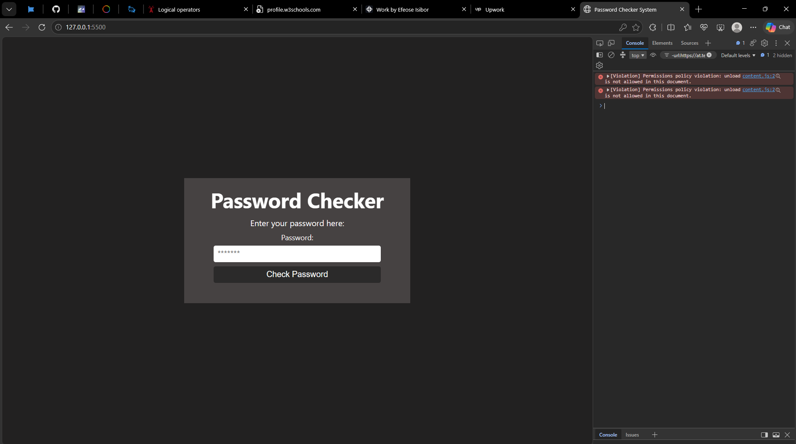

# Password Checker

A simple password validation project built with HTML, CSS, and JavaScript.

## Features

- Checks if the password is at least 8 characters long.
- Checks for a number.
- Checks for an uppercase letter.
- Checks for a lowercase letter.
- Checks for a special character.

## Technologies used

- HTML
- CSS
- JavaScript

## What I Learned

- How to use `addEventListener()` to respond to user interactions
- How to get user input using `.value`
- How to use `while` loops to check characters one by one
- How to use boolean values to track conditions
- How to use `if` and `else` statements for decision-making
- How to manipulate webpage content using `innerHTML`
- How to debug and fix logic errors

## Preview

## How to Run
1. Clone this repository.
2. Open the project folder in VS Code.
3. Open `index.html` in your browser.